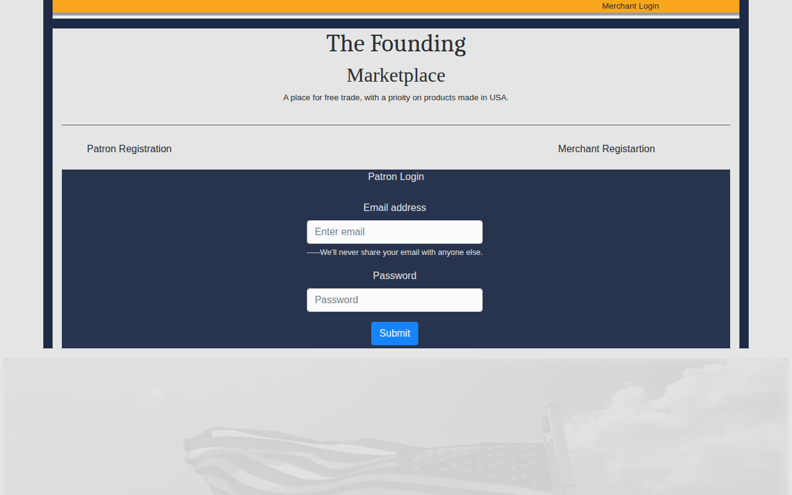

# The Founding Marketplace — Front End

React storefront for **The Founding Marketplace**, an e-commerce concept built around one idea: put where a product is made front and center. Every listing shows the maker, the product's origin, and a map pin of where it was made.



Backend API: [theFoundingMarketplaceback](https://github.com/JonathanT10/theFoundingMarketplaceback)

## Features
- Three user roles — patrons, merchants, and admins — each with their own registration, login, and dashboard
- Product catalog with photos, maker info, and an embedded Google Map pin for each product's origin
- Cart and checkout flow with a past-purchases history
- Product comments and reviews from patrons
- Merchant product management, plus admin review of merchant highlight requests

## Stack
React (Create React App) · Redux + redux-thunk · React Router · React-Bootstrap · google-maps-react · Axios · JWT-based sessions

## Run locally

```bash
npm install --legacy-peer-deps
npm start
```

Expects the [backend API](https://github.com/JonathanT10/theFoundingMarketplaceback) running locally — see that repo for setup. Built as my capstone project at devCodeCamp (2021).
